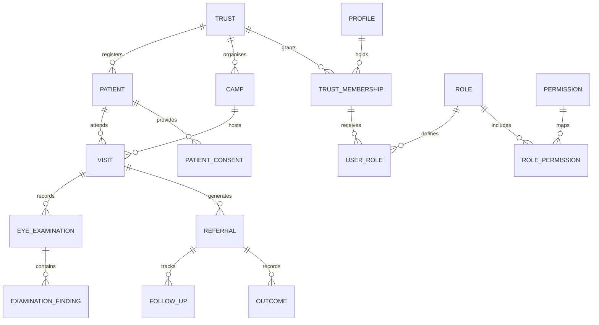

# Architecture decisions

Phase 3 local operations are documented in `PHASE_3.md`. That document supersedes earlier statements about the demo overview and closed camp/patient/visit tables once its prepared migration is explicitly activated. Hosted database changes remain on hold.

Phase 2 updates supersede the Phase 1 access strategy below: see `PHASE_2.md` for trust selection, MFA-enforced staff RPCs, recovery and the activation checklist. Clinical tables remain closed.

## Scope and boundaries

One Next.js application, two route families. Public content never queries clinical tables. Staff routes use server-verified Supabase identity and active membership. Next.js 16 proxy refreshes cookies and performs an initial claims check; server pages and the protected layout independently call the server-only `requireStaff` service. Its React cache is scoped to a render request, not shared between users. Server actions validate their own inputs and membership requirements.

Supabase is the PostgreSQL/Auth/Storage platform; Vercel is the intended host. Tailwind v4 uses the PostCSS plugin and CSS-first theme in `globals.css`; no legacy Tailwind config file is necessary. Shared semantic components provide buttons, form controls, cards, badge, table, native modal dialog, page header, empty/loading/error states and stat cards. React Hook Form and Zod power the login form. The abstract homepage artwork is local CSS/SVG and carries no external tracking or image licensing dependencies.

## Relationships

Every clinical row carries `trust_id`; composite foreign keys prevent a visit in one trust from referring to another trust’s patient or camp. Downstream records derive patient identity through their parent visit/referral. A patient is never owned by a single camp. Multiple visits to the same camp are permitted for return assessments; future idempotency/duplicate warnings belong in the visit workflow. Multiple examinations per visit and multiple findings per examination are supported.

## Tables

| Table | Purpose and important columns |
|---|---|
| `trusts` | Trust name and UUID |
| `profiles` | Auth user UUID, staff display name |
| `trust_memberships` | Trust/user composite key, active flag |
| `roles` | Six named roles |
| `permissions` | Explicit operation vocabulary |
| `role_permissions` | Future role-to-operation assignments |
| `user_roles` | Roles within a trust membership |
| `patients` | UUID, readable patient number, name, optional birth date or age/date, optional demographic/contact fields, archived time |
| `patient_consents` | Purpose-specific chronological decisions, notice version, method, recording staff |
| `camps` | UUID, trust/year camp number, date, location, type, status |
| `camp_partners` | Relational partner organisation names per camp |
| `visits` | Patient, camp, visit timestamp, examiner and screening status |
| `eye_examinations` | Visit, examiner, optional per-eye measurements |
| `examination_findings` | One finding/eye per row |
| `referrals` | Visit, reason, facility, priority, date and status |
| `follow_ups` | Referral, contact attempt, next due date, treatment status |
| `outcomes` | Referral, dated outcome, recording staff |
| `camp_media` | Private path, caption, alternative text, review/consent metadata |
| `imports` | Private upload reference, actor, status, row count |
| `import_errors` | Import row number, error code and field name; no raw patient payload |
| `audit_logs` | Actor, operation, table, record identifier, timestamp; no before/after health payload |

`auth.users` is managed by Supabase, never duplicated as an application password table. `private.camp_counters` is an internal counter table outside the exposed API schema. Patient numbers use a database sequence; camp counters use an atomic upsert scoped to trust and year. UUIDs remain the primary keys. Numbers are identifiers, not access-control secrets. Camp identifiers are assigned on creation and remain stable if a camp is rescheduled into another year. Sequence gaps are expected; IDs are not row counts.

Consent is a history, not a mutable boolean on patients. Future operations must check the latest applicable decision for a purpose. Guardian details and evidence retention require explicit future design. Date of birth and estimated age are mutually exclusive; an estimate requires its recording date. Mobile is optional and not unique because families may share a number. No Aadhaar, ABHA, billing, donation or unnecessary identity fields are collected.

Measurements are optional. Refraction and visual acuity are bounded by future entry forms and clinical review; the current text columns intentionally avoid prematurely enforcing one clinical notation. Pressure is numeric with a broad input sanity range, not diagnostic logic. Suspected findings are recorded as such; no AI diagnosis or treatment decision system is included.

## Access strategy

Phase 1 authenticated users can read only their own profile/membership and their own roles; active staff can read role/permission definitions. They cannot change membership, roles, consent, clinical records, logs, imports or media. Clinical and operational tables have no anonymous/authenticated grants or policies. Forced RLS provides a second boundary. Application code never loads a service-role key.

In Phase 2 define and review a role-permission matrix with the trust. Add explicit SQL policies that check active membership plus a trust-scoped permission. Restrict clinician operations, camp assignment, data entry and aggregate-only analyst access as needed. Implement matching server checks for helpful errors, but keep RLS as the database boundary. Avoid trusting user-editable metadata or stale client role claims. Implement last-admin protection and audited provisioning before enabling staff management.

For multiple trust memberships, Phase 1 selects one active membership only for its demo shell. Before real data features, introduce an explicit verified trust selector and pass its ID into every operation. Global super-admin powers are not implemented merely because a role named `super_admin` exists.

## Public publication boundary

Do not add public SELECT on full camps or media tables: internal fields can contain sensitive notes. Add separate, reviewed publication projections containing only approved fields. Gallery publication needs consent review, file inspection, EXIF stripping and approval. Anonymous impact needs defined measures, reporting periods, unique-person versus visit counts, and minimum-cell suppression. Do not expose a raw aggregate endpoint with arbitrary filters that enable re-identification. None of these future publication paths exist yet.

## Error and audit strategy

Validation errors use field labels and generic messages. Sign-in avoids exposing provider/database error detail. Unexpected rendering errors reach a reusable error boundary with retry. Unknown routes and unpublished camps return 404. Tables provide empty and loading patterns. Add sanitised structured operational logging later; never log credentials, tokens, raw patient rows or query parameters containing health data.

Audit triggers capture inserts/updates/deletes across application tables except the audit table itself. Logs are append-only to normal app roles. Privileged database administrators can still change database data/logs; tamper-evident external audit export is future work. Read/export auditing and Supabase Auth event review are separate concerns and are not covered by the mutation trigger.

## Phases after this handover

2. Review permission matrix, staff provisioning/recovery, MFA decisions, operational hardening, live RLS integration tests.
3. Camps, patients, consent, duplicates and visits with audited mutation services.
4. Examinations, findings, referrals, follow-ups and outcomes after clinician review.
5. Imports, reports, reviewed public media and aggregate impact. Add Recharts only when justified.

## Reference decisions

- Next.js installation and Node requirements: https://nextjs.org/docs/app/getting-started/installation
- Supabase SSR clients, cookie refresh and verified auth: https://supabase.com/docs/guides/auth/server-side/creating-a-client
- Supabase RLS and grants: https://supabase.com/docs/guides/database/postgres/row-level-security

These informed the implementation; they do not certify it as production-ready.
